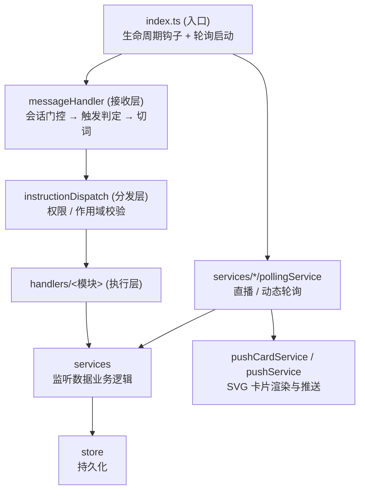

# Bilibili 监测者

一个 NapCat 插件，监听 Bilibili 直播间状态与主播动态并推送到指定会话：开播/下播、直播中与未直播时的标题/分区变化、动态发布（含图文/转发/视频/文章/表情包等类型），推送内容为渲染好的 SVG 卡片图片（失败时回退纯文本）。

## 功能

- **直播间状态轮询**：按配置间隔批量拉取监听中主播的直播间状态（B 站 `getStatusInfoByUids` 批量接口）
- **变化检测与推送**：
  - `start_stream` 开始直播（附带直播间封面图）
  - `end_stream` 结束直播
  - `restart_stream` 重新开播（直播中检测到 `live_time` 变化且在 5 分钟窗口内：先推送一次上一场结束信息，再推送重新开播卡片；超过窗口视为未观测到的完整直播，静默清理旧场数据不推送）
  - `title_changed` / `area_changed` 直播中修改标题/分区
  - `offline_title_changed` / `offline_area_changed` 未直播时修改标题/分区（独立推送类型，可单独关闭）
- **动态监听与推送**：轮询监听主播的空间动态，支持图文/转发/视频/转发视频/文章/直播开播等动态类型解析；表情包以图片内嵌文本原位置替换
- **同接数监听**：采集开播期间的同接数快照（时间加权平均），支持输出同接变化图表
- **B 站账号登录**：私聊扫码登录（二维码自动刷新），登录后可使用动态监听；原生配置面板展示登录状态
- **SVG 卡片推送**：直播/动态变化以图片卡片形式推送，封面右上角带直播/未直播状态角标，时间显示为事件发生时间（开播推送为开播时间）；渲染失败自动回退纯文本
- **开播 @ 提醒**：可按主播订阅开播 @ 提醒（`live mention`），也可为整个群开启开播 @全体成员（`live mention all`）
- **监听上限管理**：每个会话有监听主播数量上限（直播/同接/动态独立计数），超级管理员可查看/调整
- **推送类型可配置**：配置面板中按类型勾选需要推送的变化
- **WebUI**：内置三个页面（状态与配置 / 会话管理 / 帮助文档），会话管理页可批量启停群与好友的推送

## 指令

指令前缀固定为 `#bili`（插件内部常量，不可配置）。触发方式在配置项「指令触发方式」中多选：`指令 参数` 与 `@机器人 指令 参数` 相互独立，全不勾选则不触发任何指令。

### 直播监听

| 指令 | 说明 |
|------|------|
| `#bili live add <主播uid>` | 添加主播监听（仅管理员） |
| `#bili live remove <主播uid>` | 移除主播监听（仅管理员） |
| `#bili live list` | 查看当前监听的主播列表 |
| `#bili live mention <主播uid>` | 订阅主播开播 @ 提醒（仅群聊） |
| `#bili live unmention <主播uid>` | 取消订阅开播 @ 提醒（仅群聊） |
| `#bili live help` | 查看指令帮助 |

### 开播 @全体成员

| 指令 | 说明 |
|------|------|
| `#bili live mention all` | 开启本群开播 @全体成员提醒（仅群聊，管理员） |
| `#bili live unmention all` | 关闭本群开播 @全体成员提醒（仅群聊，管理员） |

### 同接监听

| 指令 | 说明 |
|------|------|
| `#bili live online add <主播uid>` | 添加主播到同接数监听列表（仅管理员） |
| `#bili live online remove <主播uid>` | 从同接数监听列表移除主播（仅管理员） |
| `#bili live online list` | 查看当前正在监听同接数的主播列表 |
| `#bili live online show <主播uid>` | 查看主播本场直播的同接数变化图表 |
| `#bili live online max` | 查看/设置同接监听上限（形态同 `live max`） |

### 动态监听

| 指令 | 说明 |
|------|------|
| `#bili dyn add <主播uid>` | 添加主播到动态监听列表（仅管理员） |
| `#bili dyn remove <主播uid>` | 从动态监听列表移除主播（仅管理员） |
| `#bili dyn latest <主播uid>` | 查看主播最新一条动态 |
| `#bili dyn list` | 查看当前监听动态的主播列表 |
| `#bili dyn help` | 查看动态监听指令帮助 |

### 账号管理（仅私聊，超级管理员）

| 指令 | 说明 |
|------|------|
| `#bili user login` | 扫码登录 Bilibili 账号 |
| `#bili user logout` | 登出 Bilibili 账号 |
| `#bili user status` | 查询当前登录状态 |
| `#bili user help` | 查看账号管理指令帮助 |

### 监听上限（`live` / `online` / `dyn` 三套形态一致）

超级管理员在配置项 `adminUsers` 中配置（WebUI 为标签输入，运行期为数组）。`live max`：

| 指令 | 说明 |
|------|------|
| `#bili live max` | 查看当前会话监听上限（群管理员也可用） |
| `#bili live max <监听数>` | 设置当前群监听上限（群聊，超管） |
| `#bili live max <监听数> <group\|private> <id>` | 修改指定会话监听上限（私聊，超管） |

## 配置

配置字段的唯一声明源是 `packages/shared/src/config.ts` 的 `FIELDS`（类型、默认值、清洗、原生面板、WebUI 表单均由它派生）。字段集固定为：

| 配置项 | 说明 | 默认值 |
|--------|------|--------|
| `adminUsers` | 超级管理员 QQ 号（WebUI 标签输入，运行期为数组） | 空 |
| `triggerModes` | 指令触发方式（`prefix` / `atBot`，可多选） | 两者都开 |
| `pollIntervalSeconds` | 直播状态轮询间隔（秒，最小 1） | `60` |
| `dynPollIntervalSeconds` | 动态轮询间隔（秒，最小 1） | `300` |
| `pushTypes` | 需要推送的变化类型（多选，空选 = 不推送） | 全部类型 |
| `mentionGroupSize` | 开播 @全体成员时每组 @ 的人数（最小 1） | `10` |

> 插件级全局启停由 NapCat 宿主负责（配置中不含 `enabled`）。群/好友级的启停是**会话级配置**，存储在数据目录的 `bilibiliSessionConfig.json`，不写进配置文件，默认开启。

配置可在 NapCat 原生插件配置面板或插件自带的 WebUI「状态」页中修改。

## 项目结构

```
napcat-plugin-bilibili-monitor/
├── packages/
│   ├── plugin/                            # 插件后端（发布物）
│   │   ├── src/
│   │   │   ├── index.ts                   # 生命周期入口
│   │   │   ├── config.ts                  # 原生配置 Schema（由 shared FIELDS 派生）
│   │   │   ├── types.ts                   # 仅重导出 shared 类型
│   │   │   ├── onebotEvent.ts             # 自持的 EventType 枚举
│   │   │   ├── core/                      # state（全局单例）/ admin（角色）/ atAll（@全体成员）
│   │   │   ├── api/                       # B 站 HTTP 封装（baseRequest / authRequest + 各接口）
│   │   │   ├── handlers/                  # 接收层 / 注册表 / 分发层 / 各模块 handler
│   │   │   ├── services/                  # 轮询、解析、推送卡片、登录、会话配置、WebUI API
│   │   │   ├── store/                     # 持久化（BaseStore / BaseRecordStore + 各数据文件）
│   │   │   │   └── migration/             # 旧数据与旧配置迁移
│   │   │   ├── utils/                     # messageSend（唯一发送出口）/ atBotPrefix / format
│   │   │   └── assets/                    # 帮助图片（生成物，入库）
│   │   ├── scripts/generateHelp/          # 帮助生成脚本（cmds/ 为权威源）
│   │   ├── types/napcat-types/            # 上游类型垫片（手工抄录）
│   │   └── test/                          # vitest 单测
│   ├── shared/                            # 跨包共享（配置/展示占位符/UI 骨架/帮助类型）
│   └── webui/                             # React SPA（单文件 HTML）
└── docs/                                  # 范式文档与 ADR
```

## 快速开始

### 依赖

本插件依赖外部渲染插件 [napcat-plugin-svg-render](https://github.com/AliubYiero/napcat-plugin-svg-convert)（用于将 SVG 卡片渲染为图片，默认端口 `6099`），需先安装并启用，且版本 **≥ 1.1.0**（宽度计算依赖其 `fontFamily` 参数透传）。渲染插件不可用或渲染失败时，推送会自动回退纯文本。

图片渲染默认使用思源黑体（Noto Sans CJK SC）。**若渲染宿主系统未安装思源黑体，文本尺寸计算会出错，可能导致图片渲染错行、溢出等不可预计的情况**，请先安装字体：

```bash
# Linux
sudo apt install fonts-noto-cjk

# macOS
brew install --cask font-source-han-sans
```

Windows 需手动下载并安装思源黑体（Noto Sans CJK SC / Source Han Sans）字体文件。

### 安装

从 GitHub Release 下载 zip 包，解压到 NapCat 的 `plugins` 目录（包内含 `index.mjs` / `package.json` / `webui/` / `assets/`）。

### 开发

```bash
pnpm install

pnpm build          # 构建 WebUI + 插件后端（输出 packages/plugin/dist）
pnpm dev:webui      # WebUI 前端开发服务器（实时预览）
pnpm help:generate  # 重建帮助产物（图片 / 文本 / 结构化数据，产物入库）

pnpm lint           # biome check（含格式化检查）
pnpm check          # typecheck + test（提 PR / 发版前的判定命令）

# 验收一律以 lint + check + build 全绿为准
```

### 调试 & 热重载

通过 Vite 插件 `napcatHmrPlugin` 集成热重载（已在 `packages/plugin/vite.config.ts` 配置），需要在 NapCat 端安装 `napcat-plugin-debug` 插件并启用，通过 `.env` 中的 `WS_URL` 与 `TOKEN` 连接远程 NapCat 实例：

```bash
pnpm deploy         # 构建 + 部署 + 热重载（正式 id）
pnpm deploy:dev     # 以 <name>-dev 新 id 部署，不覆盖远程正式插件
```

## 架构说明

### 分层架构



### 核心设计

| 设计 | 实现位置 | 说明 |
|------|----------|------|
| 单例状态 | `packages/plugin/src/core/state.ts` | `pluginState` 全局单例，持有 ctx、config、logger、stats |
| 配置单源 | `packages/shared/src/config.ts` | `FIELDS` 派生类型/默认值/清洗/原生面板/WebUI 表单 |
| 会话配置 | `packages/plugin/src/services/sessionConfigService.ts` | 群/好友启停与开播 @全体成员，唯一读写入口，默认开启 |
| 持久化分层 | `packages/plugin/src/store/storeFile.ts` | `BaseStore` / `BaseRecordStore` + `{version, data}` 包裹 |
| 数据迁移 | `packages/plugin/src/store/migration/` | 启动时先迁数据再迁配置，迁移早于配置清洗 |
| 指令三层链路 | `packages/plugin/src/handlers/` | 接收层 → 注册表（装配）→ 分发层（统一校验）→ handler |
| 变化检测 | `packages/plugin/src/store/biliLiveRoomStore.ts` | 轮询比对直播间状态，产出 `ChangeType` 事件 |
| 动态解析 | `packages/plugin/src/services/dyn/parserService.ts` | 纯函数模块，解析各类动态为渲染所需结构 |
| 推送渲染 | `packages/plugin/src/services/live/pushCardService.ts` | SVG 卡片渲染，失败回退纯文本 |
| 帮助产物 | `packages/plugin/scripts/generateHelp/` | cmds 权威源 → 图片 / 文本 / 结构化数据，`GET /help` 原样返回 |

架构决策记录见 [docs/adr](docs/adr/)，范式文档见 [docs/](docs/)，领域术语见 [CONTEXT.md](CONTEXT.md)。

## WebUI 页面

插件自带的 WebUI（`插件 ID` 对应的拓展页面）包含三个页面：

| 页面 | 说明 | 主要接口 |
|------|------|----------|
| 状态 | 运行状态、统计、配置表单（由 shared FIELDS 派生） | `GET /status`、`GET/POST /config` |
| 会话 | 群与好友列表、逐个/批量启停推送 | `GET /sessions`、`POST /sessions/:type/:id/config`、`POST /sessions/bulk-config` |
| 帮助 | 全部指令面板（含搜索与分页签） | `GET /help` |

登录 B 站账号不在 WebUI 中提供，仍通过私聊指令 `#bili user login` 完成。

## CI/CD 自动发布

推送 `v*` 格式的 tag 即可自动构建并创建 GitHub Release：

```bash
git tag v1.0.0
git push origin v1.0.0
```

`.github/workflows/release.yml` 会依次执行 `pnpm check`、`pnpm build`，打包 `index.mjs` / `package.json` / `webui/` / `assets/` 为 zip 并校验缺件（缺 `assets/` 会导致帮助静默降级为文本，因此在发布前直接失败）。`.github/workflows/ci.yml` 在每次 push / PR 上执行 lint + check + build。版本号在 `packages/plugin/package.json` 维护。

## 许可证

MIT License
